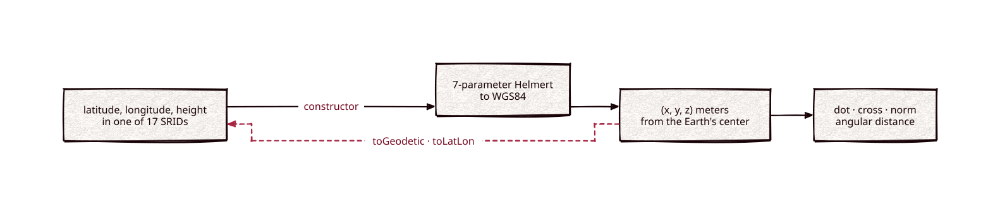

# cartesian

[](https://github.com/Kronuz/cartesian/actions/workflows/ci.yml)
[](LICENSE)


Geodetic to geocentric conversion for C++20: turn latitude, longitude, and
height into Earth-centered `(x, y, z)` vectors on WGS84, convert between 17
datums, and do the vector math geospatial code needs. For geometry on points of
the Earth's surface.



## ✨ Highlights

- **Both directions.** Construct from latitude, longitude, and height in degrees
  or radians; get back `toGeodetic()`, `toLatLon()`, or a degrees-minutes-seconds
  string.
- **17 reference systems**: WGS84, NAD83, NAD27, OSGB36, ED50, Tokyo, and more,
  each Helmert-transformed to WGS84.
- **Vector algebra**: dot and cross products, norms, normalization, and the
  angular distance between two surface points.
- **No dependencies** beyond the standard library.

## 📦 Installation

Requires a C++20 compiler and CMake 3.14 or newer; it compiles one source file.
CI builds it on Linux (x86_64, arm64), macOS (arm64, x86_64), and FreeBSD, plus
ASan, UBSan, and TSan builds.

```cmake
include(FetchContent)
FetchContent_Declare(cartesian
  GIT_REPOSITORY https://github.com/Kronuz/cartesian.git
  GIT_TAG        main)
FetchContent_MakeAvailable(cartesian)

target_link_libraries(my_app PRIVATE cartesian::cartesian)
```

## 🚀 Quick start

```cpp
#include "cartesian.h"

#include <cstdio>

int main() {
	Cartesian sf(37.7749, -122.4194, 0.0, Cartesian::Units::DEGREES);   // San Francisco
	Cartesian ny(40.7128, -74.0060, 0.0, Cartesian::Units::DEGREES);    // New York
	Cartesian uk(51.5, -0.12, 0.0, Cartesian::Units::DEGREES, OSGB36);   // converted to WGS84

	sf.normalize();
	ny.normalize();
	std::printf("angle: %.4f rad\n", sf.distance(ny));                  // on the unit sphere

	auto [lat, lon] = uk.toLatLon();                                   // WGS84 degrees
	std::printf("%s\n", uk.toDegMinSec().c_str());
}
```

[`examples/demo.cc`](examples/demo.cc) round-trips Quito with its elevation and
measures San Francisco to New York.

## 🎯 When to use it

- ✅ Geometry on Earth coordinates: angles between places, datum conversion,
  vectors for spatial indexes.
- ❌ Map projections (UTM, Web Mercator): it converts to and from Earth-centered
  coordinates only.

## 📚 Documentation

- [docs/API.md](docs/API.md): constructors, SRIDs, conversions, operators, errors,
  and caveats.
- [ARCHITECTURE.md](ARCHITECTURE.md): the ellipsoid math and the Helmert
  transform.
- [AGENTS.md](AGENTS.md): repository map, invariants, and traps.

## 🛠️ Building and testing

```sh
cmake -B build && cmake --build build && ctest --test-dir build
./build/cartesian_demo
```

## 🤝 Contributing

Issues and pull requests are welcome. Read [AGENTS.md](AGENTS.md) first. CI must
pass on every platform.

## 📄 License

MIT, Copyright (c) 2015-2018 Dubalu LLC. See [LICENSE](LICENSE). Extracted from
[Xapiand](https://github.com/Kronuz/Xapiand), where it backs geospatial search.
